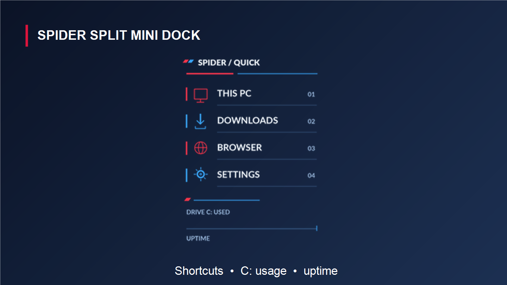
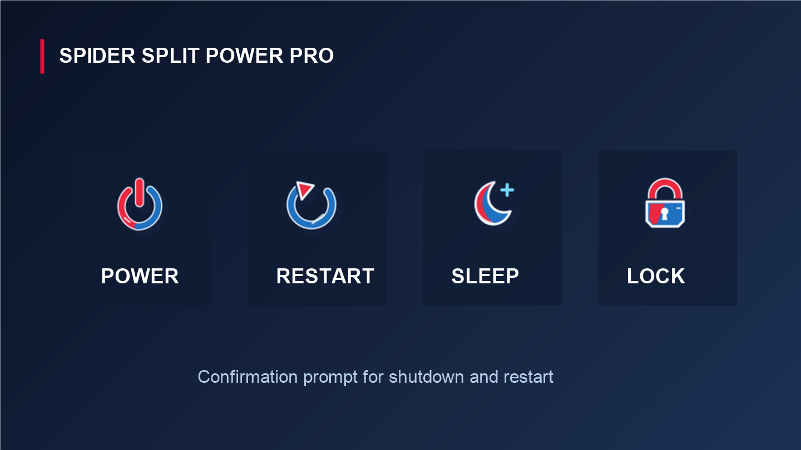
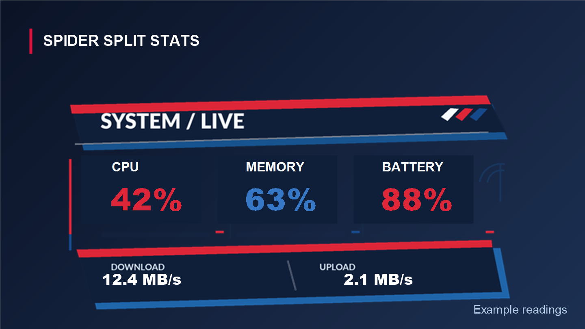

# Spider Split Rainmeter Skins

Four Spider-Man-inspired Rainmeter skins:

- **SPIDER_SPLIT_BOLD** — animated comic-style date and clock.
- **SPIDER_SPLIT_MINI_DOCK** — shortcuts, C: drive usage, and uptime.
- **SPIDER_SPLIT_POWER_PRO** — power, restart, sleep, and lock buttons.
- **SPIDER_SPLIT_STATS** — CPU, memory, battery, and network readings.

## Previews

These preview images are composed from each skin's artwork. The readings shown in the Stats preview are examples, not live system values.

### SPIDER_SPLIT_BOLD

### SPIDER_SPLIT_MINI_DOCK

### SPIDER_SPLIT_POWER_PRO

### SPIDER_SPLIT_STATS

## Install

Copy the four skin folders into your Rainmeter `Skins` folder, then choose **Refresh all** in Rainmeter. Load each skin from Manage Rainmeter.

## Power button behavior

The Power Pro shutdown and restart buttons show a confirmation prompt before running the Windows action. Sleep suspends Windows; Lock locks the current session. Review the scripts in `SPIDER_SPLIT_POWER_PRO/@Resources` before loading the skin.

The skin metadata currently identifies the author as OpenAI and labels the skins for personal use.
